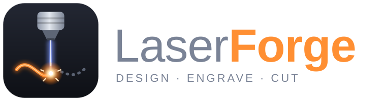
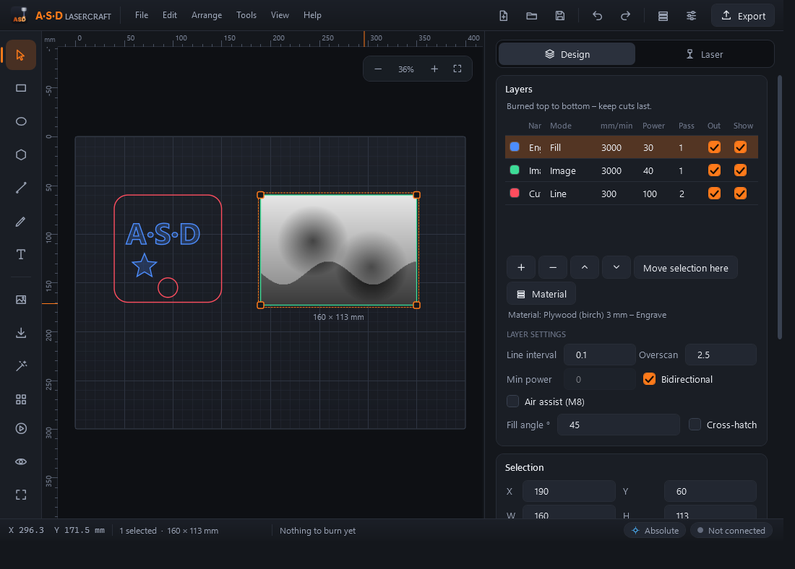
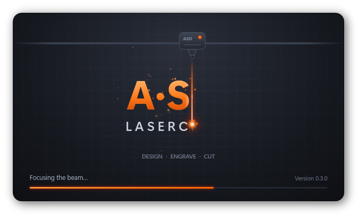
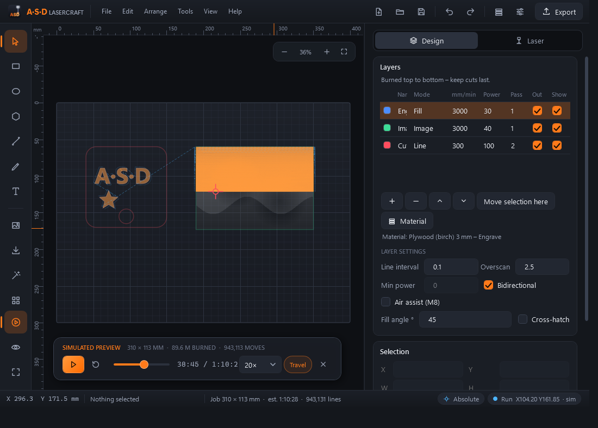
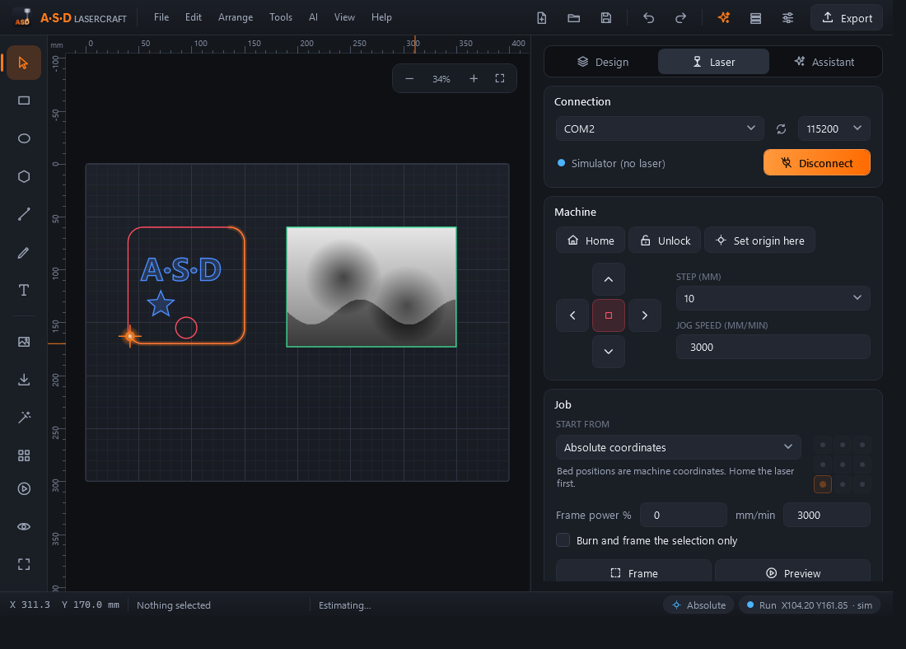
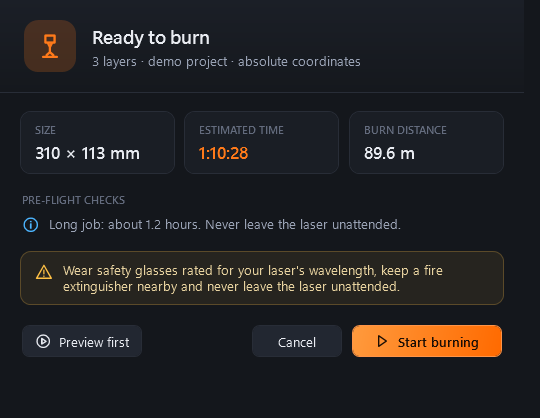
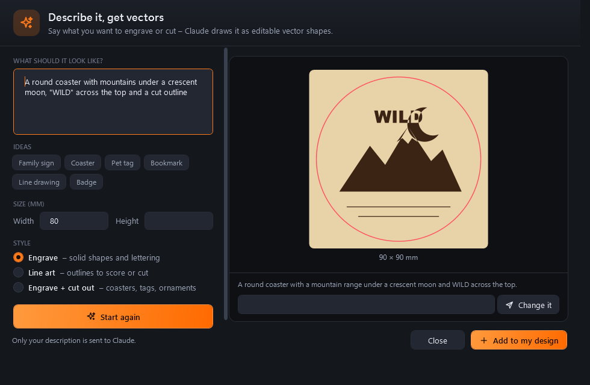
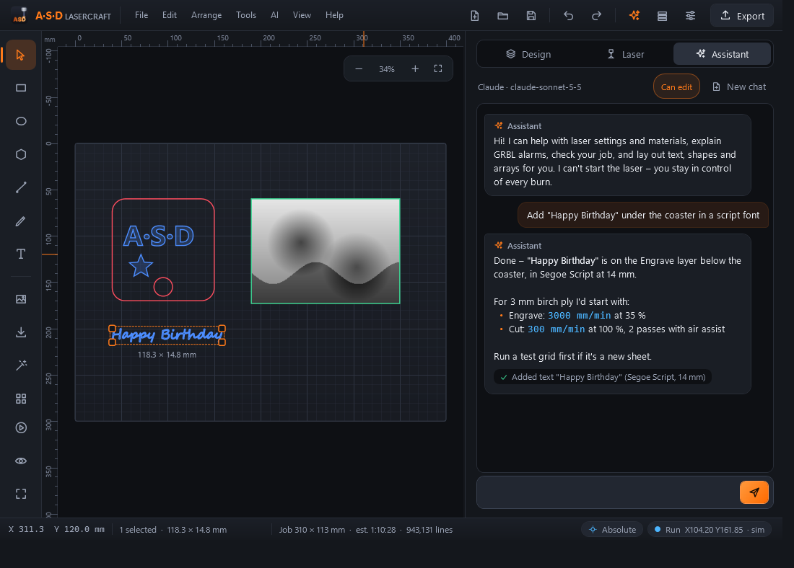
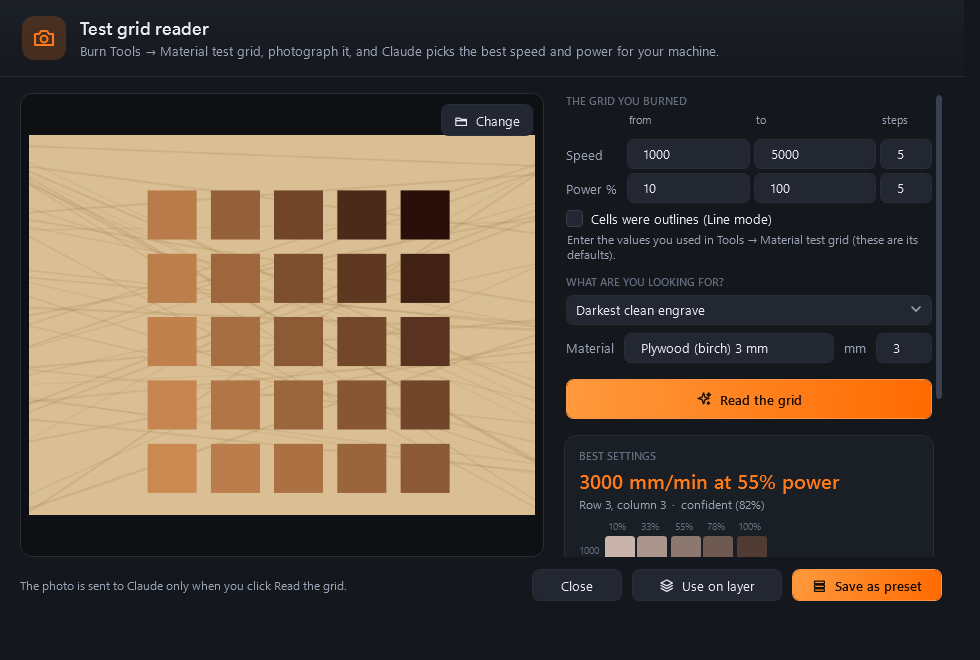
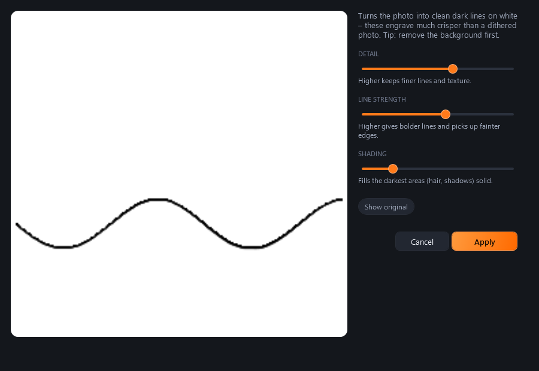

<p align="center"></p>

# A·S·D Lasercraft

A Windows design-and-burn app for **GRBL diode lasers** (xTool, Atomstack, Sculpfun, Ortur, Two Trees, NEJE and similar). Draw or import artwork, assign it to layers with their own speed and power, frame the job to check size and placement, then stream it to the laser over USB.

<p align="center"></p>

> **Status: v0.4.** Adds optional AI features powered by Claude. The core engine (G-code generation, dithering, GRBL streaming, SVG import, kerf, tracing, AI parsing and tools) is covered by 105 tests including golden G-code files, and CI opens every window of the app on Windows before each build is published. Always test new settings on scrap first.

## AI features (optional)

| Feature | What it does | Where it runs |
|---|---|---|
| **Describe a design** (Ctrl+G) | Type what you want – *"a round coaster with mountains and a moon, cut out"* – and Claude draws it as editable vectors. Lettering is outlined with your own installed fonts. Preview it, ask for changes ("make the text bigger"), then add it. Engrave, line-art and engrave-and-cut styles. | Claude (only the description is sent) |
| **Read a test grid photo** | Burn a material test grid, photograph it, and Claude picks the best cell for your goal (dark engrave, light engrave, photo, or cut-through). Save it as a material preset or put it straight on a layer. The speeds and powers come from the grid itself, so they're exact. | Claude (the photo, when you click Read) |
| **Assistant** (Ctrl+K) | A chat tab that knows your project, machine, presets and console. Ask about settings and materials, get alarms explained, or have it add text and shapes, set layers, apply presets, make arrays and generate artwork. Every change is one undo step; switch "Can edit" off for advice only. **It can never frame, start or stop the laser.** | Claude (messages plus a text summary of the project) |
| **Remove background** | Whitens everything behind the subject so it isn't burned. AI model for busy backgrounds (a one-off 4.6 MB download of U²-Net, checksum-verified), or an instant plain-background mode. | Your PC, offline |
| **Photo to line art** | Turns a photo into clean dark lines on white, with detail, strength and shading sliders and a live preview. Line art engraves far crisper than a dithered photo. | Your PC, offline |
| **Auto-tune** | One click sets brightness, contrast, gamma, invert and dithering for the layer's material – lightening for wood, inverting for slate and anodised aluminium. | Your PC, offline |
| **GRBL explanations** | Every `ALARM:` and `error:` in the console gets a plain-English meaning and fix underneath. | Your PC, offline |

To use the Claude features, add your own API key from [console.anthropic.com](https://console.anthropic.com/settings/keys) in **AI → AI settings**. It's stored in Windows Credential Manager (never in a file), and usage is billed to your Anthropic account. You can hide all AI features in the same window.

## Features

| Feature | How it works |
|---|---|
| **Normal engraving** | `Fill` layers scan-line hatch closed shapes (even-odd rule, so holes in letters stay open). Line interval sets resolution. |
| **Cutting** | `Line` layers trace outlines, with multiple passes. Inner shapes are cut before the shapes around them, and travel is minimised. |
| **Image engraving** | `Image` layers raster bitmaps. Modes: Jarvis, Stucki, Floyd–Steinberg, Atkinson, threshold, or true grayscale (variable power). Brightness, contrast, gamma and invert are adjustable. Optional raster preview shows the exact dots that will burn. |
| **Vector drawing / editing** | Rectangle, ellipse, polygon, line and pen tools. Select, move, resize with handles, rotate, mirror, duplicate, align. Snap to grid. Undo/redo. |
| **Text & shapes** | Any installed Windows font is converted to outlines. SVG import (paths, arcs, curves, groups, transforms, real-world units). |
| **Layers with their own settings** | Each layer has its own mode, speed, power, passes, line interval, overscan, bidirectional scanning, min power and air assist (M8). Layers burn top-to-bottom. |
| **Test sizing before burn** | **Frame** traces the job's bounding box with the laser off, or at a capped 1–5 % pointer power. **Material test grid** generates a labelled speed × power matrix. |
| **Resize images, etc.** | Drag handles or type exact X/Y/W/H in mm, with aspect lock. Images rotate in 90° steps and mirror. |
| **Scan offset** | Per-speed compensation for bidirectional engraving, so edges are crisp instead of doubled. A test card helps you measure it. |
| **Fill angle & cross-hatch** | Engrave at any angle, or add a 90° second pass for darker, even fills. |
| **Kerf & tabs** | Outlines are offset by half the kerf so parts come out at size; tabs keep parts in the sheet. |
| **Job origin** | Absolute, user origin (G54) or current head position, with a 9-point anchor. Frame and burn always agree. |
| **Simulated preview** | Play the actual G-code on the canvas with a scrub bar before burning. Images show as their real dithered burn. |
| **Pre-flight checks** | A "Ready to burn" summary flags outside-the-bed, overscan past the edge, 0 % power, open paths on fill layers, cut-before-engrave and more. |
| **Material library** | Presets for common materials; save your own and apply them to a layer in one click. |
| **Arrays & tracing** | Grid and circular arrays; trace an image into vector outlines. |
| **Simulator** | Pick "Simulator (no laser)" as the port to try everything without hardware. |
| **Machine control** | COM port connect, home ($H), unlock ($X), set work origin, jog pad, pause/resume (feed hold), emergency stop (soft reset), live head position, console for raw GRBL commands, G-code export. |

## Screenshots

| | |
|---|---|
| <br>Start-up: the head engraves the logo | <br>Simulated preview with scrub bar |
| <br>Running a job: glowing head and burn trail | <br>Pre-flight checks before burning |
| <br>Describe a design: Claude draws it as vectors | <br>The assistant adding text to the project |
| <br>Reading a test grid photo | <br>Photo to line art, on your PC |

## Project layout

```
AsdLasercraft.sln
├─ src/AsdLasercraft.Core      Pure .NET 8 engine, no UI or package dependencies
│   ├─ Geometry             Vec2, Bounds, Polyline, Transform2D, curve/arc flattening
│   ├─ Model                LaserProject, Layer, VectorShape, ImageShape, ShapeFactory, MachineProfile
│   ├─ Ai                   Claude client, design generator, test-grid reader, assistant + tools
│   ├─ Imaging              Adjust → resample → dither; background removal, line art, auto-tune
│   ├─ Gcode                GcodeGenerator (line / fill / raster / frame), scan offset, angled fill, kerf/tabs, preflight
│   ├─ Grbl                 Character-counting streamer, status parser, error/alarm explanations, GrblSimulator
│   ├─ Tools                Material library, arrays, image tracing
│   ├─ Import               SVG importer (including text runs for real-font outlining)
│   ├─ Generators           Material test grid, seven-segment label font
│   └─ Serialization        .asdl JSON project files, snapshot undo/redo
├─ src/AsdLasercraft.App       WPF front end (Windows only)
│   ├─ Themes                     Dark theme and line icons
│   ├─ Controls                   DesignCanvas (work area, rulers, preview), Glyph icon control
│   ├─ Views / Dialogs            Splash, Ready-to-burn, material library, About, AI settings, design, test grid, line art
│   ├─ Services                   Laser connection, settings, update check, AI services, key storage, background model, smoke test
│   └─ MainWindow.*.cs            Main window, split by area (file, edit, layers, laser, preview, tools, AI)
├─ tests/AsdLasercraft.Core.Tests    Dependency-free test runner (105 tests) + golden G-code files
└─ installer/                    Inno Setup script
```

## Build and run

You need Windows 10/11 and the [.NET 8 SDK](https://dotnet.microsoft.com/download/dotnet/8.0). Visual Studio 2022 (with the ".NET desktop development" workload) or JetBrains Rider work well.

```powershell
git clone <this repo>
cd LaserForge   # repo folder
dotnet run --project src/AsdLasercraft.App            # run the app
dotnet run --project tests/AsdLasercraft.Core.Tests   # run the engine tests
```

Each push is built on GitHub Actions: tests, golden G-code comparison, a UI smoke test that opens every window, a self-contained `AsdLasercraft.exe` and an installer (`AsdLasercraft-x.y.z-setup.exe`), all as build artifacts. No .NET install is needed to run them.

To publish a release, bump `VersionPrefix`, add a CHANGELOG entry and push a tag such as `v0.3.0`. The release workflow attaches the installer and a portable zip, and the app's update check will offer it to users.

If you change G-code output on purpose, push a commit with `[update-golden]` in the message to refresh the golden files (review the diff!). `[screenshots]` refreshes the images in `docs/screenshots`.

## Setting up your laser

A·S·D Lasercraft assumes **GRBL 1.1 in laser mode**. Check these settings once from the Laser tab console (send `$$` to list them):

| Setting | Meaning | Typical value |
|---|---|---|
| `$32=1` | Laser mode. The laser turns off during rapid moves and pauses, and power follows motion. **Required.** | 1 |
| `$30` | S value for 100 % power. Must match *Tools → Machine settings → Max S*. | 1000 (some boards 255) |
| `$130` / `$131` | Bed size in mm. Set the same in Machine settings. | e.g. 400 |
| `$22` | Homing enabled. If 0, use **Set work origin here** instead of Home. | 1 |

Coordinates: the canvas uses a top-left origin, like the screen. Most diode lasers home to the **front-left**, so Y is flipped on output by default. If your laser homes to the back-left, untick *Origin front-left* in Machine settings.

## Typical workflow

1. **Tools → Material test grid** on a scrap of your material. Pick the cell that looks best (or photograph it and use **AI → Read a test grid photo**) and save it in the **Material library**.
2. Draw or import artwork (or drag it onto the canvas). Put engraving on a `Fill` or `Image` layer and cut lines on a `Line` layer at the **bottom** of the list, so cuts happen last.
3. Apply a material preset or set speed, power and passes per layer. Add kerf and tabs to cut layers.
4. Choose where the job starts on the Laser tab (absolute, user origin or current position).
5. **Preview** (Ctrl+P) to watch the job, then Connect → Home → **Frame** → **Start** and read the pre-flight checks.

Shortcuts: `Ctrl+G` describe a design, `Ctrl+K` assistant, `Ctrl+P` simulated preview (Space play/pause, Esc close), `Ctrl+M` material library, `+`/`−` zoom, `V` select, `R` rectangle, `E` ellipse, `G` polygon, `L` line, `P` pen (Enter or double-click finishes, click the first point to close), `T` text, `F` zoom to fit, arrows nudge 1 mm (Shift 10 mm, Ctrl 0.1 mm), `Ctrl+D` duplicate, `Ctrl+Z`/`Ctrl+Y` undo/redo, `Esc` cancel. Hold Shift to draw squares and circles, Alt to disable snapping, and Space or middle-drag to pan.

## Safety

Lasers start fires and cause permanent eye damage. Always wear safety glasses rated for your laser's wavelength (typically 445–455 nm for diodes). Never leave a running job unattended, and keep an extinguisher within reach. **Stop** sends a feed hold followed by a GRBL soft reset, which kills the beam immediately. It does not replace your machine's physical emergency stop.

## Versioning

The version is set once in `Directory.Build.props` (`VersionPrefix`). CI stamps each build with its run number and commit, so **Help → About** shows something like `0.4.0 (build 12, a1b2c3d)`. Generated G-code files record the version in their header. Changes are listed in [CHANGELOG.md](CHANGELOG.md).

## Author

**Alastair Stewart Duncan** – [alastair@aduncan.co.uk](mailto:alastair@aduncan.co.uk)

© 2026 Alastair Stewart Duncan. All rights reserved.

## Roadmap ideas

- Boolean operations (union, difference) and a node editor for vectors
- Camera overlay for positioning on the material (and AI auto-placement on it)
- Rotary attachment support
- Job resume after an interruption
- DXF and PDF import
- Several saved machine profiles
- Ruida/CO₂ support behind the existing `ILineTransport` / generator abstractions
